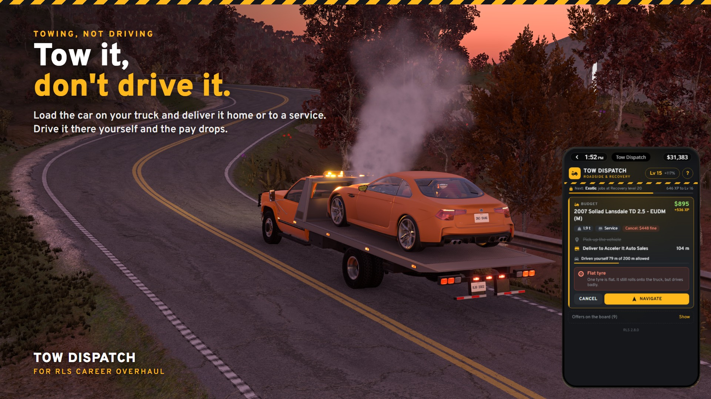
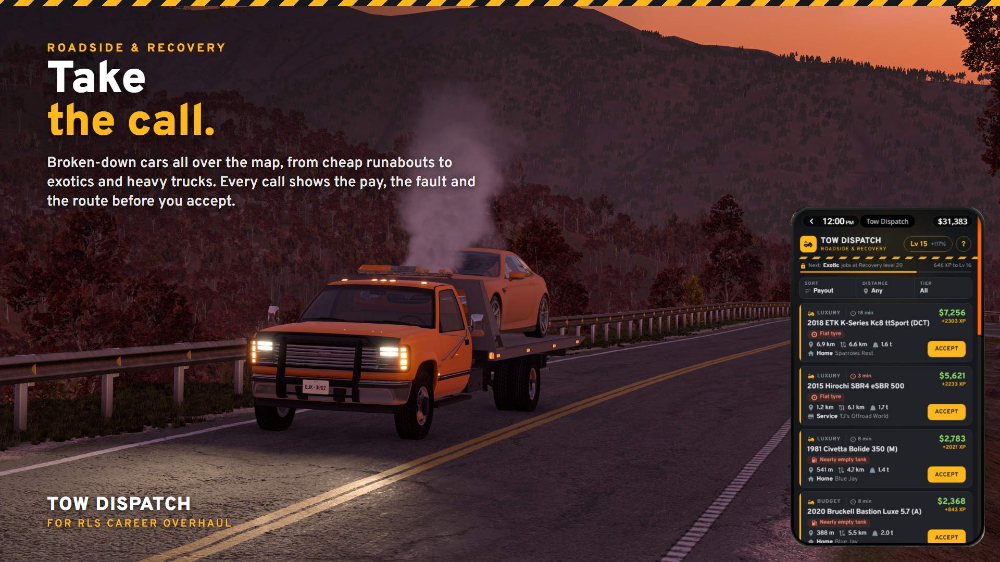
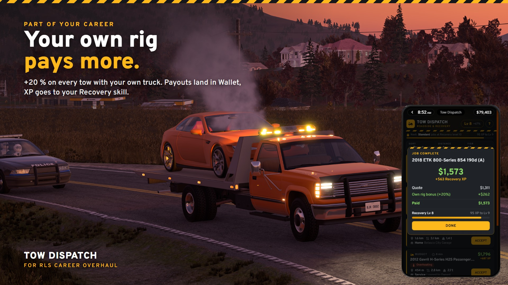
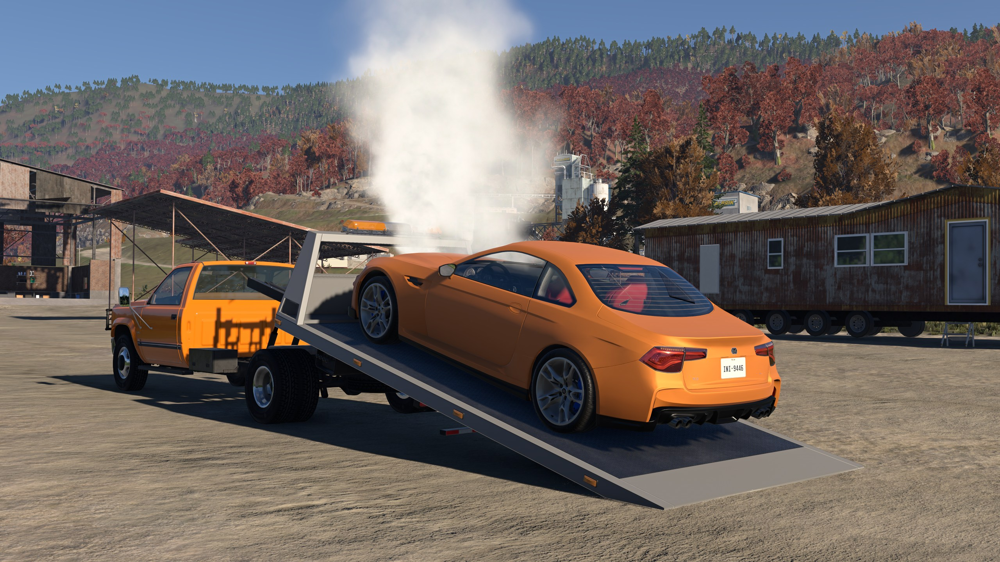
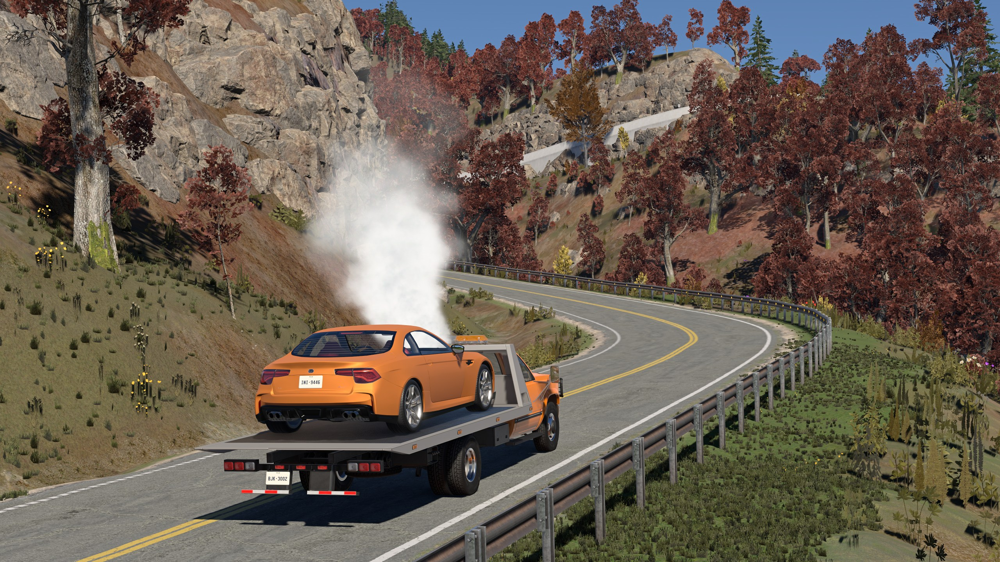
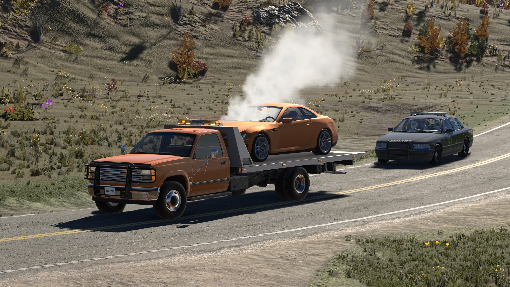
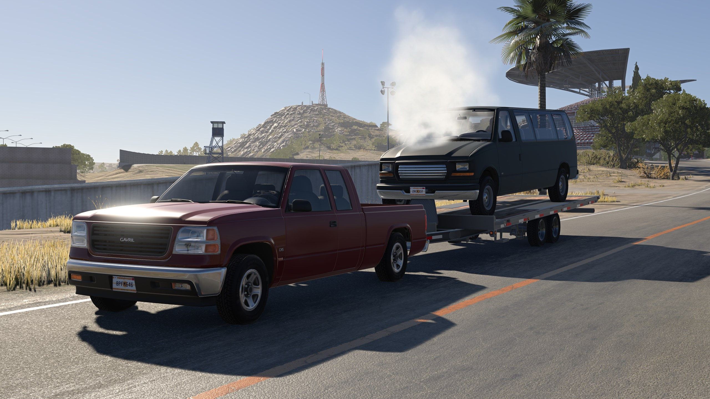

# Tow Dispatch

**Run a tow business in your RLS career.** Tow Dispatch is an add-on for
[RLS Career Overhaul](https://github.com/RLS-Modding/rls_career_overhaul) in BeamNG.drive
that adds a new way to earn money: answering calls from drivers whose cars broke down and
towing them home or to a service.

> **Status:** playable beta, not released yet. Tested on The Gap and West Coast USA with RLS 2.8.0.

## What you do

Somewhere on the map a car has run out of fuel, blown a tyre, overheated or lost its engine.
The owner calls dispatch. You pick the call on your phone, drive out with your tow truck or a
car trailer, load the car and bring it to the owner's home or to a dealership's service bay.
The price is agreed before you leave, so you always know what a job is worth.

As your Recovery skill grows, bigger and pricier calls open up: from cheap runabouts to
luxury cars, exotics and heavy trucks. Better jobs pay better, and a bigger truck lets you
take them.

## Features

- **Tow Dispatch phone app** in the RLS phone, styled like a tow company's dispatch screen.
- **A living job board** on every map: 10–14 calls of every tier at once. New calls come in
  over time and each one expires on its own clock. No rerolling: you work with what comes in.
- **Everything up front:** each call shows the payout, the fault, the vehicle and its weight,
  how far it is from you, how long the tow is and where it goes. Sort by payout or distance
  and filter by tier and distance.
- **Four kinds of breakdown**, each one you can see and feel:
  - **Nearly empty tank** – it runs for a few hundred metres,
  - **Flat tyre** – it still rolls, but drives badly,
  - **Overheating** – no coolant left, the engine overheats as soon as it runs,
  - **Failing engine** – misfires and stalls.

  Every car can still be driven a few metres onto a flatbed, so a winch helps but is never
  required.
- **Towing pays, driving does not:** getting the car onto your truck is fine, but if you just
  drive the customer's car to the destination yourself, the pay drops and you get no XP.
- **Progression you can see:** calls above your level are listed as locked, with the payout
  and the level that unlocks them. Tiers unlock at the same Recovery levels as RLS repo.
- **Fair pay:** short and long tows pay about the same per minute, so long routes are worth
  taking. A typical tow of about 6 km pays a little more per minute than repo work, which you
  simply drive away; repo pays more for very short drives, towing for long ones. A tow of an
  exotic or a heavy truck pays about as much as a Job Broker delivery of one.
- **Care counts:** damage you cause on the way is taken from the payout, at most half of it.
  Cancelling is free until you move the car; after that it costs a fine.
- **Own rig bonus:** no tow truck yet? Rent a pickup and a car trailer at the Job Broker depot.
  Once you own your rig, every tow pays 20 % more (10 % with your own truck and a rented
  trailer).
- **Part of your RLS career:** XP goes to the RLS Recovery skill (shared with repo and Off-Road
  Recovery), payouts appear in Wallet as recovery income, finished jobs go to the logbook, and
  the board and an active job are saved with your career, even with the car on a flatbed.

## Requirements

- BeamNG.drive 0.40
- RLS Career Overhaul 2.8.x (the app warns on other versions)

Works alongside the original RLS repo jobs, which stay as they are, and alongside
RLS Carjacking & Theft, which leaves tow customers' cars alone.

## Installation

Not released yet. Once it is: put the zip into your BeamNG `mods` folder next to RLS and
keep it zipped. Start or load an RLS career and open **Tow Dispatch** on the phone.

## How to play

1. Get a tow truck or a car trailer: your own, or rented at the Job Broker depot.
2. Open **Tow Dispatch** and pick a call. Tap **?** in the app for a short guide.
3. **Accept** it and drive to the car; **Navigate** sets the route.
4. Load the car on your truck or trailer. Once it leaves its spot, it is your responsibility.
5. Take it to the green marker at the destination and stop. You get the agreed price minus
   any damage you caused, plus a bonus if the rig is your own, and Recovery XP.

One job at a time.

## Gallery

| | |
|---|---|
|  |  |
|  |  |

## Known limitations

- A job started on one map waits there while you travel; a car on a flatbed does not travel
  with you.
- Tested on The Gap and West Coast USA so far; other RLS maps should work but are not verified.
- The app still has developer tools at the bottom (**Debug tools**); release builds hide them.

## Development

The repository root is the mod root. See [AGENTS.md](AGENTS.md) for the layout and workflow,
[docs/spec.md](docs/spec.md) for the specification, [docs/rls-integration.md](docs/rls-integration.md)
for how the add-on uses RLS and [docs/release.md](docs/release.md) for releasing.

- Tests (LuaJIT): `tools/test.sh`
- Deploy to the game for testing (Windows): `tools/dev/deploy.ps1`
- Package: `tools/package.sh` → `dist/tow_repo_hub.zip`

## License

[MIT](LICENSE). RLS Career Overhaul is a separate project with its own licenses; this add-on
uses its interfaces and does not ship RLS code.
